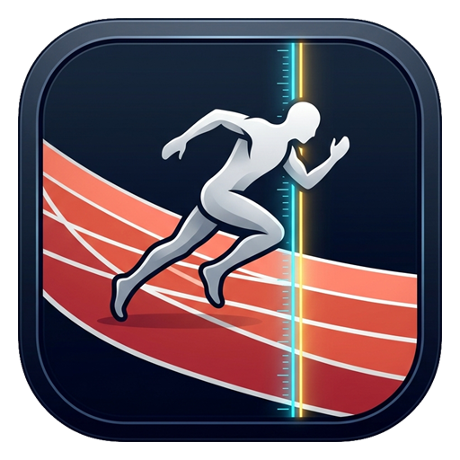

<p align="center">
  
</p>

<h1 align="center">OptiFinish Studio</h1>

<p align="center">
  <strong>Clean-room slit-scan photo-finish timing, IdentiLynx video synchronization, and athletics meet evaluation suite for Windows.</strong>
</p>

<p align="center">
  <a href="LICENSE"></a>
  
  
</p>

---

## Overview

**OptiFinish Studio** is a standalone, clean-room Windows Forms application for athletics photo-finish timing and race evaluation. Built with zero external NuGet dependencies on top of .NET Framework 4.x (`System.Windows.Forms`, `System.Drawing`), it supports both synthetic race simulation and direct decoding of native FinishLynx binary event streams.

## Key Features

- **Slit-Scan Photo-Finish Engine (`SlitScanEngine.cs`)**
  - Decodes native FinishLynx event packages (`.evn`) and 16,000-byte block camera streams (`.i01`, `.i02`) supporting EtherLynx RGB555 RLE and 24-bit `8xBlock` formats.
  - Synchronizes slit-scan time hairlines with IdentiLynx multi-frame video streams.
  - Includes motion-energy peak auto-evaluation and annotated PNG photo-finish export with results table.
- **Interactive Evaluation Workspace (`MainWindow.cs`, `EventWindowControl.cs`, `SlitScanViewportControl.cs`)**
  - Multi-event MDI workspace with cascade, tile horizontal, tile vertical, and fullscreen view modes.
  - Hairline time evaluation with configurable precision (`Seconds`, `Fifths`, `Tenths`, `Hundredths`, `Thousandths`, `TenThousandths`) and delta / length modes.
  - Image adjustments (brightness, contrast, gamma), white-balance point sampling, enhancement bands, crop/autocrop, and custom overlays (text, closest/hash time, lane labels).
- **Meet Database & File Interoperability (`MeetDatabaseService.cs`)**
  - Imports and exports `.evt` meet schedules, `.ppl` athlete directories, `.spl` split files, `.lif`/`.csv` official results, ReacTime false-start data, and `.optr` native race packages.
  - Built-in sample presets (e.g., 100m Hurdles Women, 100m Men Dead-Heat).
- **Scoreboard & Hardware Telemetry (`HardwareTransceiver.cs`, `HardwareControlPanel.cs`)**
  - RS-232 serial port and UDP network broadcast support (`LSS` scoreboard scripts) with live running clock controls.
  - Manual and simulated ultrasonic wind gauge telemetry.
- **Multilingual Localization & Configuration (`LynxLocalization.cs`, `LynxConfigService.cs`, `LynxExtendedConfig.cs`)**
  - Embedded 17-language `LangPack.dat` resource with optional external `.lng` overrides.
  - Interoperates with `OptiFinish.cfg`, `OptiFinish.ext.cfg`, and `C:\Lynx\Lynx.cfg`.

## Building from Source

OptiFinish Studio compiles directly with the Windows `.NET Framework 4.x` C# compiler (`csc.exe`)—no Visual Studio solution or NuGet restore required:

```powershell
& "C:\Windows\Microsoft.NET\Framework64\v4.0.30319\csc.exe" `
  /nologo /target:winexe /optimize+ /platform:anycpu `
  /win32icon:OptiFinish.ico `
  /resource:LynxIcons.png,OptiFinish.LynxIcons.png `
  /resource:LangPack.dat,OptiFinish.LangPack.dat `
  /resource:OptiFinish.png,OptiFinish.OptiFinish.png `
  /out:OptiFinish.exe *.cs
```

## Running & Self-Test

Launch the desktop workspace:

```powershell
.\OptiFinish.exe
```

Run the built-in verification suite (evaluates sample presets, exports annotated PNG/LIF/OPTR outputs, and verifies native `.evn`/`.i01`/`.i02` decoding into `SampleData\SelfTestReport.txt`):

```powershell
.\OptiFinish.exe --self-test
```

## Project Structure

| File | Purpose |
| --- | --- |
| `Program.cs` | Application entry point, DPI setup, icon check, and `--self-test` runner |
| `MainWindow.cs` | Top-level MDI shell, menus, toolbars, shortcuts, and workspace management |
| `EventWindowControl.cs` | Event results grid, split management, and camera viewport container |
| `SlitScanViewportControl.cs` | Interactive slit-scan & IdentiLynx video viewport with overlays and zoom |
| `SlitScanEngine.cs` | Native `.i01`/`.i02` decoders, motion peak detection, and annotated export |
| `MeetDatabaseService.cs` | `.evn`, `.evt`, `.ppl`, `.lif`, `.csv`, `.spl`, and `.optr` file I/O |
| `TimingModels.cs` | Core race, camera, competitor, split, and precision formatting models |
| `HardwareControlPanel.cs` / `HardwareTransceiver.cs` | Hardware control panel, RS-232 serial, and UDP scoreboard transceiver |
| `LynxConfigService.cs` / `LynxExtendedConfig.cs` | Configuration persistence (`OptiFinish.cfg`, `OptiFinish.ext.cfg`) |
| `OptionsDialog.cs` / `FeatureDialogs.cs` | Preferences, camera/wind/split/about, and fullscreen viewer dialogs |
| `LynxLocalization.cs` / `LangPack.dat` | 17-language embedded localization engine and language pack |
| `LynxIcons.cs` / `LynxIcons.png` | Toolbar sprite atlas loader |
| `AppIconGenerator.cs` / `OptiFinish.png` / `OptiFinish.ico` | Embedded application icon artwork and multi-resolution `.ico` generator |

## License

This project is licensed under the MIT License — see the [LICENSE](LICENSE) file for details.
